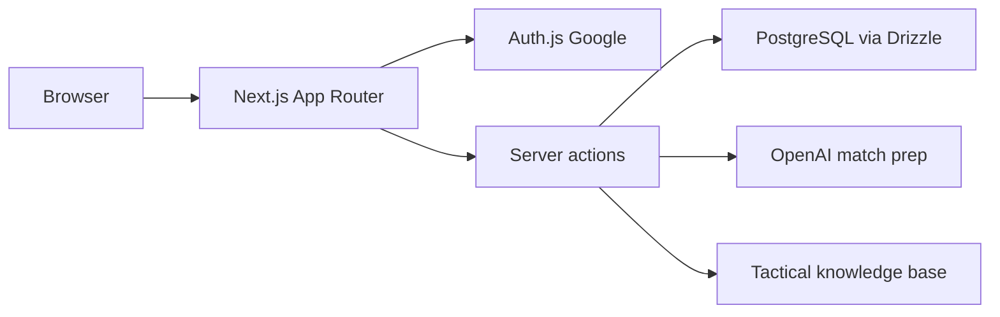

# Tennis Match Tracker

Personal tennis journal: opponents, structured scores, score-aware stats, and AI match preparation. The product brand in the UI is **PrepCourt**.

**Development plan:** The full incremental plan is in [docs/DEVELOPMENT_PLAN.md](docs/DEVELOPMENT_PLAN.md).

## Architecture



| Layer | Where |
|---|---|
| UI shell, pages, i18n | `src/app`, `src/components`, `messages/` |
| Auth | `src/lib/auth.ts`, `src/middleware.ts` |
| Data | `src/db` |
| Match prep | `src/lib/match-prep` |
| Brand | `public/brand`, `src/components/brand`, `src/app/icon.tsx` |

Deploy target is Railway (app + Postgres) on the platform URL. A custom domain is not part of the current release.

## Requirements

- Node.js 20+ (LTS recommended)
- pnpm 9+

## Quick start

1. Install dependencies:

   ```bash
   pnpm install
   ```

2. Run the app:

   ```bash
   pnpm dev
   ```

3. Verify quality gates:

   ```bash
   pnpm lint
   pnpm typecheck
   pnpm test
   ```

4. Validate typed hello route:

   - Open `http://localhost:3000/api/hello`
   - Expected JSON shape:
     - `message: string`
     - `timestamp: string (ISO)`

## Auth (Phase 1b)

- **NextAuth v5** with Google provider and **Drizzle adapter** (PostgreSQL).
- Copy `.env.example` to `.env.local`, set `AUTH_SECRET` (e.g. `npx auth secret`), `AUTH_GOOGLE_ID`, `AUTH_GOOGLE_SECRET`, and `DATABASE_URL`.
- Create [Google OAuth credentials](https://console.cloud.google.com/apis/credentials) and add redirect URI: `http://localhost:3000/api/auth/callback/google` (and your production URL when deployed).
- Push the auth schema to the DB: `pnpm db:push`. Optional: `pnpm db:studio` to inspect data.
- Landing page `/` and `/login` are public; all other routes require sign-in.

## Deploy (Phase 1c)

- Deploy to **Railway** with PostgreSQL and GitHub auto-deploy. Step-by-step: [docs/RAILWAY_DEPLOY.md](docs/RAILWAY_DEPLOY.md).
- After connecting the repo and adding env vars (`DATABASE_URL`, `AUTH_SECRET`, `AUTH_GOOGLE_*`), run `pnpm db:push` against the Railway database and add the production callback URL in Google OAuth.

## Scripts

- `pnpm dev`: start local dev server
- `pnpm build`: production build
- `pnpm start`: start production server
- `pnpm lint`: ESLint checks
- `pnpm typecheck`: strict TypeScript checks
- `pnpm test`: run Vitest tests once
- `pnpm test:watch`: run tests in watch mode
- `pnpm format`: format code with Prettier
- `pnpm format:check`: verify formatting
- `pnpm check`: run lint + typecheck + tests
- `pnpm db:push`: push Drizzle schema to the database (requires `DATABASE_URL`)
- `pnpm db:studio`: open Drizzle Studio (requires `DATABASE_URL`)

## Debugging baseline

- Use the included VS Code/Cursor launch configs:
  - **Next: full stack debug**
  - **Next: server only**
  - **Chrome: frontend only**
- Set breakpoints in:
  - `src/app/api/hello/route.ts` (server route)
  - React components in `src/app/*` (frontend)
- Inspect:
  - Browser devtools Network tab for `/api/hello`
  - Terminal logs for server-side errors
