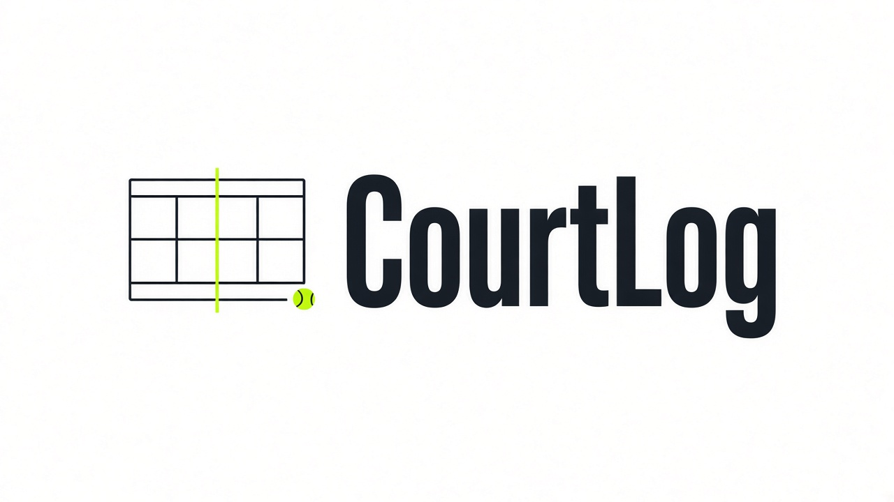
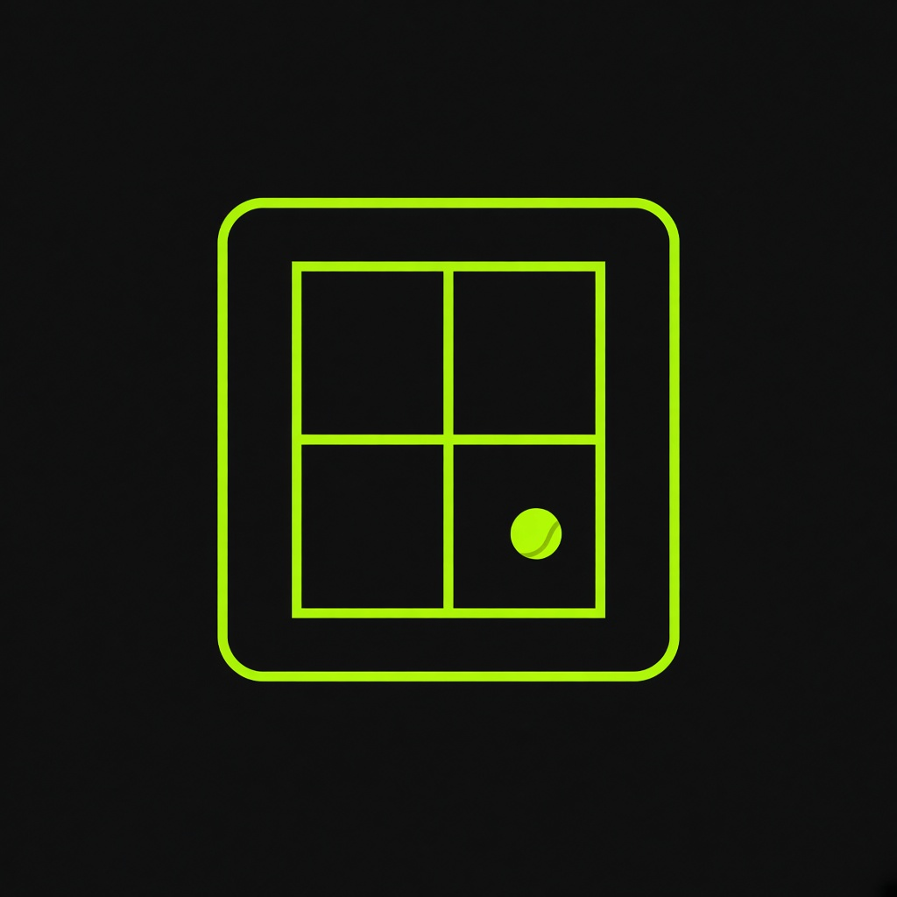
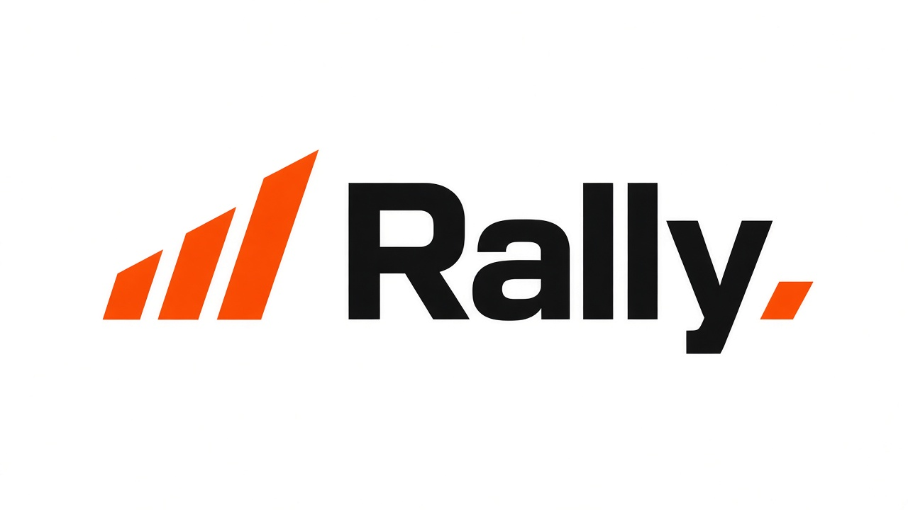
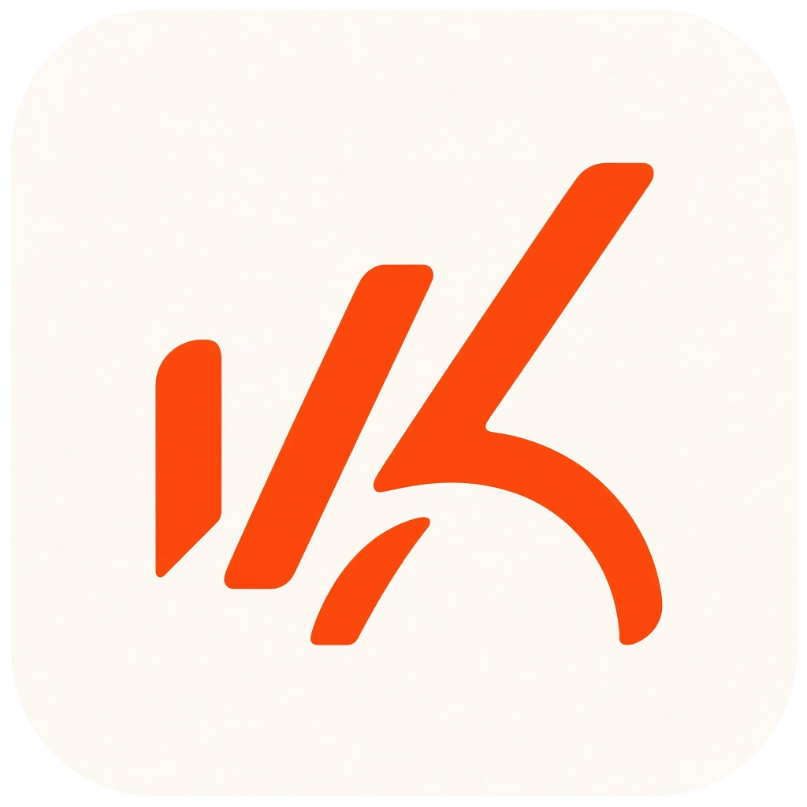
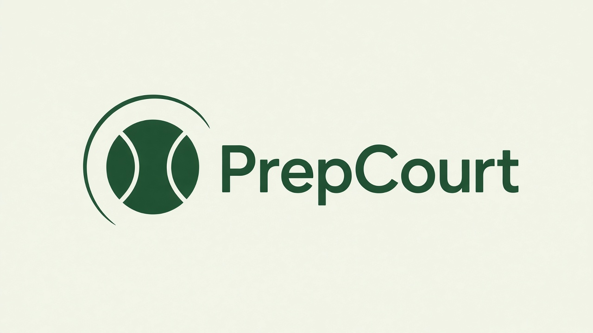
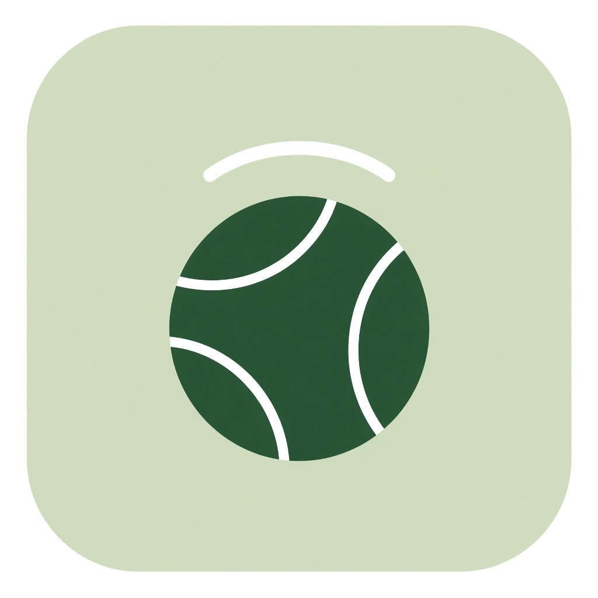

# Phase 6 prep — UX/UI research & branding alternatives

Prepared ahead of **Phase 6 (Polish)**: logo + favicon, header/auth branding, metadata, and visual polish.

---

## 1. Competitive & best-practice research

Apps reviewed (tennis-specific + adjacent personal/sports trackers):

| App | Category | Why it matters for us |
|---|---|---|
| **SwingVision** | Tennis / pickleball AI video | Specialist tennis UI: dark accessible surfaces, shot heatmaps, highlight-first review, audio feedback. Strong “see → improve” loop. |
| **Deuce** (concept) | Tennis analytics mobile | Live match card as home hero; schedule tabs (upcoming / live / completed); bottom nav for thumb reach. |
| **PlaySight** | Smart-court companion | Dashboard as filterable progress over time; profile + leaderboard as secondary; overview → stroke → points drill-down. |
| **CourtTime** (research) | Tennis visual analytics | Schneiderman: overview first → zoom/filter → details; outcomes as the common thread; keep the human in the loop. |
| **HEAD Tennis sensor** (case study) | Stroke feedback | Persistent (not popover) metrics; most valuable metric on top; tap for depth; non-intrusive during play. |
| **Strava** | Activity feed | Single accent color; map/activity as hero; 3-up stat grid; flat cards; Record as primary action; tabular numbers. |
| **Garmin Connect** | Data cockpit | True-black instrument panel; one brand accent; functional color for metrics; number-as-hero hierarchy; dense but clean. |
| **WHOOP / Oura** | Recovery scoring | Score rings, pitch-black canvas, neon accents, ALL-CAPS labels — “glanceable readiness.” |
| **Nike Run Club / Hevy / Strong** | Logging + coaching | Clear pillars (feed / activity / go); big touch targets; set/log tables; one primary CTA. |

### Cross-cutting best practices (apply regardless of alternative)

1. **One accent, functional secondary color** — Brand hue for CTAs/active nav; win/loss/unfinished stay semantic (green / red / muted), never recolored by brand fashion.
2. **Number-as-hero** — Win rates, differentials, and scores use tabular/monospace digits; labels stay small and quiet (matches our Tufte sparkline direction).
3. **Overview → filter → detail** — Dashboard summary → combinable filters → match/player/advice detail (already aligned with Phase 5b/5c).
4. **Mobile-first chrome** — Bottom or thumb-friendly nav; primary “log match” / “get advice” actions obvious; 44px+ targets; outdoor-readable contrast.
5. **Persistent primary metrics** — Don’t hide win rate / recent form behind popovers; keep a stable strip users can trust.
6. **Feed + instrument hybrid** — Activity apps win with a chronological feed; analytics apps win with dense stats. We need both: recent matches feed *and* score-aware charts.
7. **Advice is a product moment** — AI prep (Phase 5c) should feel like a distinct “coach” surface, not another form dump — clear hierarchy: opponent → plan → history.
8. **Avoid generic SaaS defaults** — Current shell uses Inter + slate/neutral shadcn gray. Phase 6 should pick a *directional* palette and type so the app feels like tennis performance software, not a dashboard template.

### Fit to *this* product

Our app is **not** video/sensor (SwingVision) and **not** social (Strava). Closest product shape:

- Personal **match journal** (log + opponents)
- **Score-aware analytics** (Tufte sparkline, singles/doubles WR)
- **LLM match prep** (saved advice)

So the winning UX borrows Strava’s logging clarity, Garmin’s metric hierarchy, and SwingVision’s “actionable after the hit” tone — without requiring video or social.

---

## 2. Three UX/UI alternatives

Each alternative includes: visual direction, UX pattern map, token sketch, and generated **logo + favicon** (see folders below). Working brand names are placeholders for Phase 6; the real product name can stay “Tennis Match Tracker” or adopt one of these.

Assets live under `docs/branding/alt-{a,b,c}/`.

---

### Alternative A — **CourtLog** (“Court instrument”)

**Inspiration:** Garmin Connect, WHOOP, SwingVision dark UI  
**Thesis:** The app is a pocket instrument panel for competitive club players who want density and clarity after every match.





| Layer | Spec |
|---|---|
| **Canvas** | Dark-first `#0A0A0A` / elevated `#121417`; optional light mode as secondary |
| **Accent** | Neon court lime `#B8FF3C` (CTAs, active nav, sparkline focus) |
| **Semantics** | Win `#3DDC97`, loss `#FF5C5C`, unfinished `#6B7280` |
| **Type** | Condensed sans for stats (e.g. *DM Sans* / *IBM Plex Sans Condensed*); UI sans for labels |
| **Surfaces** | Flat panels, hairline dividers, almost no shadows |
| **Nav** | Desktop: slim left rail with lime active state; mobile: bottom tabs + lime “+ Match” FAB |
| **Dashboard** | Big singles/doubles WR tiles; Tufte sparkline on black with lime selection; recent matches as dense rows |
| **Prepare** | “Briefing” card with monospace-ish section headers; history as timeline ticks |
| **Logo** | Overhead court glyph + **CourtLog** wordmark; lime net + ball accents |
| **Favicon** | Charcoal rounded square, lime court lines + ball |

**Pros:** Matches analytics ambition; excellent outdoor/night contrast; distinct from current light SaaS look.  
**Cons:** Dark-first is a bigger CSS/token migration; some users prefer light journals.

**Phase 6 implementation notes:** Map shadcn CSS variables to dark tokens; replace Inter; wire logo in shell + login; export SVG favicon from the mark.

---

### Alternative B — **Rally** (“Match feed”)

**Inspiration:** Strava Record/feed, Deuce mobile, Nike Run Club pillars  
**Thesis:** Logging and reviewing matches should feel as fast as posting an activity — light canvas, one hot accent, feed-first.





| Layer | Spec |
|---|---|
| **Canvas** | Warm white `#FAFAF8` / coal dark mode `#0F0F0F` |
| **Accent** | Clay orange `#E85D04` (single chromatic brand color) |
| **Semantics** | Win/loss keep green/red; orange reserved for brand/CTA only |
| **Type** | Geometric sans for UI (*Satoshi* / *Geist*); tabular figures for scores |
| **Surfaces** | Flat cards with hairlines; match cards lead with score + opponent, 3-up mini stats |
| **Nav** | Bottom bar: Home / Players / **Record** (center orange) / Prepare / You |
| **Dashboard** | Feed of match cards above charts; filters as sticky chips |
| **Prepare** | “Game plan” as a shareable card stack (tactics → checklist → history) |
| **Logo** | Ascending sparkline / racket-throat bars + **Rally** wordmark |
| **Favicon** | Light rounded square, orange abstract bars |

**Pros:** Fastest path from “I played” → logged; closest to habits users already have in Strava; light mode = smaller delta from today’s UI.  
**Cons:** Orange clay can read “running” if court metaphors are weak; must keep tennis cues in iconography and empty states.

**Phase 6 implementation notes:** Promote “New match” to a center/primary action; restyle cards to feed pattern; keep charts but demote below the feed on mobile.

---

### Alternative C — **PrepCourt** (“Club coach”)

**Inspiration:** SwingVision “what to work on next,” HEAD non-intrusive coaching, Calm/club hospitality warmth (without meditation clichés)  
**Thesis:** Differentiate on Phase 5c — the product feels like a club coach in your pocket; journaling and analytics support preparation.





| Layer | Spec |
|---|---|
| **Canvas** | Soft sage wash `#F4F7F2` → white content wells; subtle court-line pattern optional in hero only |
| **Accent** | Forest court green `#2D6A4F` + secondary ball yellow `#D4E157` for highlights |
| **Semantics** | Same win/loss/unfinished rules; green accent ≠ automatic “win” (use check icons + labels) |
| **Type** | Rounded modern sans for brand (*Nunito Sans* / *Plus Jakarta*); clearer serif *only* for advice titles if needed — never for chrome |
| **Surfaces** | Soft radius, light elevation on interactive cards only (forms, advice); lists stay flat |
| **Nav** | Sidebar/top with green active underline; Prepare elevated as a primary destination |
| **Dashboard** | “Next prep” callout when an upcoming advice exists; then WR + sparkline |
| **Prepare** | Hero of the product: large opponent header, Generate CTA, structured advice sections, saved history |
| **Logo** | Tennis ball + trajectory arc + **PrepCourt** wordmark |
| **Favicon** | Sage rounded square, green ball + white seam + arc |

**Pros:** Best story for AI prep; friendlier for mixed-skill club players; strong outdoor brand read (court green).  
**Cons:** Soft surfaces can dilute Tufte density if overused; need discipline so it doesn’t feel “wellness.”

**Phase 6 implementation notes:** Landing/login lead with logo + one prep-oriented line; Prepare nav weight increased; advice typography gets the expressive treatment.

---

## 3. Side-by-side comparison

| Criterion | A CourtLog | B Rally | C PrepCourt |
|---|---|---|---|
| Primary metaphor | Instrument / cockpit | Activity feed | Club coach |
| Best for | Analytics-heavy users | Fast daily logging | Prep-first users |
| Migration cost from current UI | High (dark + type) | Medium | Medium–high |
| Accent | Lime `#B8FF3C` | Clay `#E85D04` | Forest `#2D6A4F` |
| Aligns with Tufte sparkline | Excellent | Good | Good if charts stay sparse |
| Aligns with AI Prepare | Good | Good | Excellent |
| Outdoor / phone glare | Excellent (dark) | Good (high contrast orange) | Good (if contrast checked) |

---

## 4. Recommendation for Phase 6 kickoff

**Chosen for Phase 6:** Alternative C — PrepCourt. Custom domain is deferred so the polish branch can deploy on the existing Railway URL.

---

## 5. Asset checklist (when implementing Phase 6)

For the chosen alternative:

- [ ] Trace logo to SVG (header + auth + OG)
- [ ] Favicon set: `icon.svg`, `favicon.ico`, apple-touch-icon
- [ ] Wire in `src/app` metadata + `app-shell` header
- [ ] Map CSS variables in `globals.css`
- [ ] Replace default Inter with chosen font pair
- [ ] Lighthouse contrast pass on mobile

Generated raster drafts (this prep):

```
docs/branding/alt-a/logo.jpg
docs/branding/alt-a/favicon.jpg
docs/branding/alt-b/logo.jpg
docs/branding/alt-b/favicon.jpg
docs/branding/alt-c/logo.jpg
docs/branding/alt-c/favicon.jpg
```

---

## Sources (selected)

- [SwingVision — Behind the Design (Apple)](https://developer.apple.com/news/?id=0pg4dthn)
- [Strava Record redesign (2025)](https://press.strava.com/articles/strava-launches-redesigned-record-experience)
- [Garmin Connect / Strava design notes (awesome-ios-design-md)](https://github.com/Meliwat/awesome-ios-design-md)
- [HEAD Tennis sensor companion case study](https://jiaoshi-design.webflow.io/works/head-tennis)
- [CourtTime visual analytics requirements](https://dominikjaeckle.com/projects/2019/courttime/)
- Deuce tennis analytics mobile UI (match card + bottom nav pattern)
